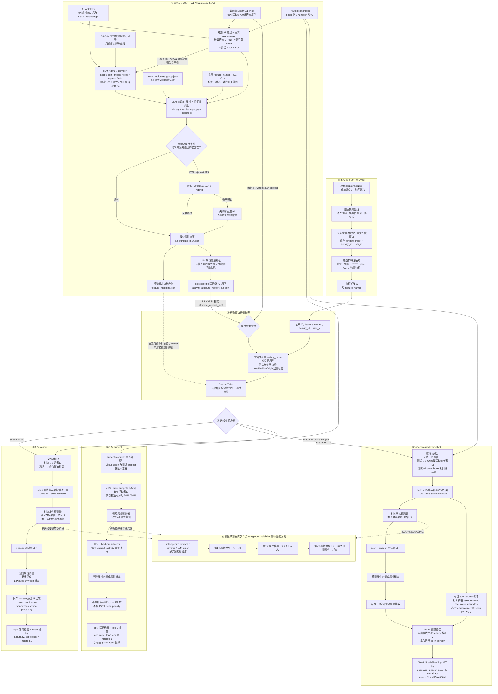

# ZSHAR 从 IMU 到活动标签的完整流程

下图按当前项目代码展示两条汇合的数据流：传感器窗口及其统计特征构成模型输入；
活动级语义属性向量构成属性监督和活动原型。ZSL 与 GZSL 可以按 split 使用 A2，
跨 subject 当前使用数据集配置中的公共属性向量。

## 三个场景的核心区别

| 场景 | 属性模型训练窗口 | 测试窗口 | 活动候选集合 | 当前属性原型 |
|---|---|---|---|---|
| ZSL | 仅 seen 活动；不按 subject 隔离 | 仅 unseen 活动 | 仅 unseen 活动 | 可按 activity split 使用 A2；未指定时使用数据集公共向量 |
| GZSL | 仅 seen 活动，并排除被抽作测试的 seen 窗口 | seen 与 unseen 活动 | seen ∪ unseen | 可复用同一 activity split 的 A2；支持 seen-bias 校准 |
| 跨 subject | train subjects 的全部活动 | 完全未参与训练的 test subjects | 全部活动 | 当前固定使用数据集配置中的公共 A1；不接受 split-specific A2 root |

ZSL/GZSL 的划分轴是“活动类别”。同一个 subject 可以同时在 seen 训练窗口和 unseen
测试窗口中出现。跨 subject 的划分轴是“人员”，活动标签空间没有 seen/unseen 划分。

## 当前实现边界

1. `planner1.py` 使用完整 A1 活动原型、真实 seen/unseen 名单和语义 D_kNN/近邻，
   不再筛选 issue cards。它利用目标类别语义，但不读取 unseen 记录或测试预测。
   当前策略及重跑命令见 [完整 A1 细化说明](FULL_A1_REFINEMENT.md)。
2. `a2_attribute_plan.feature_mapping.json` 已经给出每个属性绑定后的精确特征列和索引，
   但 `pipeline/runner.py` 与 `pipeline/training.py` 当前仍把 `DatasetTable.feature_columns`
   的全部列传给每个属性模型。因此，绑定目前是可观测性审核和可追溯产物，还不是训练时
   的逐属性 feature routing。
3. `pipeline/runner.py` 当前拒绝在 `cross_subject` 场景传入 `attribute_vectors_root`，而
   `planner1.py` 也拒绝仅凭 activity-split CSV 执行 cross-subject 细化。因此跨 subject
   使用数据集配置的公共属性向量，当前没有 subject-split-specific A2。
4. 属性预测器由 `--backend` 决定。普通后端独立预测各属性；多任务后端联合预测；
   classifier-chain 后端按指定顺序预测。`autogluon_multilabel` 训练后序模型时使用前序
   真实属性，推理时使用前序预测属性。

